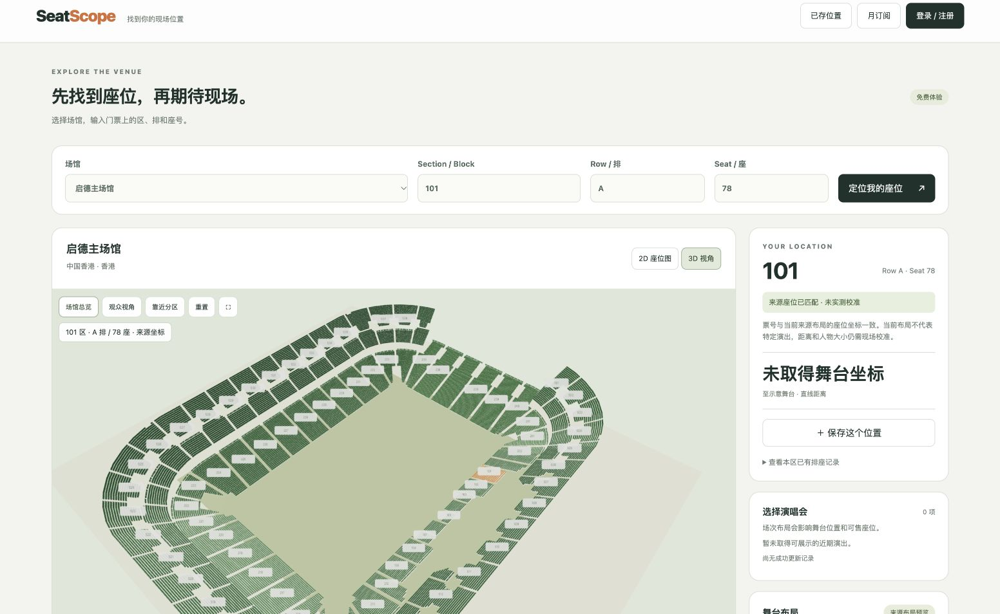

# 场馆数据准确性修复与验收

日期：2026-10-24。结论：已修复本地 MVP 的已知坐标导入和票号匹配错误；尚未完成任何场馆的独立实测验收，欧美市场仍不能作为精确米制选座产品上线。

## 本轮实际修复

1. 七馆的完整来源资产按馆、按布局加载，不再仅拿每区前三条采样搭配通用椭圆椅子。来源票号、座位 XYZ、座椅朝向、排深、舞台坐标与布局分别保留。2D 的座位点直接用三维的 X/Z；分区外轮廓由来源座位投影生成，不宣称官方建筑轮廓。
2. 启德 CAD 解码使用记录第12个字段（零起索引11）作为每座Y，不再把同层所有座位放在楼层基准高度。原始 X/Z 的符号变换与已留存解码样例一致。
3. Tottenham / MetLife / SoFi 的1,798条票号采样只有身份和屏幕热区，没有米制XYZ。取消按采样排名分配位置；匹配票号保留，入座相机及距离不再生成。未知票号也不会隐式转成模拟网格座位。
4. 来源布局严格隔离。不支持的布局、未收录票号、歧义票号不会自动选其他座位；保存位置增加布局字段，旧库通过追加列迁移。旧记录的空布局保留为null，不猜测历史演出。
5. 修复布局加载期间旧响应覆盖新坐标、点选新分区后旧响应抢回位置、错误深链接替换成默认票区、WC别名被首条采样替换等问题。新增导入包没有来源XYZ时也不会生成票号坐标；明确提供的来源XYZ保留原精度和记录索引。
6. 来源有舞台时，人物和距离使用该布局舞台；来源没有舞台的启德只提供看台位置视角，不补舞台、人物或距离。模型距离标为“模型约…m · 非实测”，不是误差经过验证的门票距离。

## 来源覆盖

下面是**布局记录数量**，跨布局可能重复同一物理座位，不是138,856个不同实体座位。

| 场馆 | 布局 | 记录数 |
|---|---|---:|
| 启德主场馆 | bowl固定看台，无场次舞台 | 48,483 |
| 香港红馆 | center / end | 11,446 / 11,562 |
| 亚洲博览馆Arena | end / standing | 11,724 / 8,300 |
| 亚洲博览馆VIVA | end / expanded | 5,600 / 8,364 |
| 亚洲博览馆2号馆 | end | 5,080 |
| 亚洲博览馆Runway11 | end / compact | 3,800 / 1,620 |
| 台北小巨蛋 | end / center | 10,000 / 12,877 |
| 合计 | 7馆、12布局 | 138,856 |

原始清单：[seat-assets-manifest](../../shijiao-evidence/data-sources/seat-assets-manifest.json)。构建时验证每份原件SHA-256，生产数据保存于 `data/source-seats/`，`index.json`保留来源与哈希。来源记录索引在精确定位响应内保留。六馆资产自带Flytix来源地址，启德为另一种CAD字段模式；两类分别解码，未执行第三方脚本。

REA用于确认可解码字段和实现机制，不能证明来源数据经过现场测量。参考脚本证据：`ev_948657dfa2f61c7ec7aedd3236f734ce3af61239494e7e0ee273d34f6f402c47`；全量bundle证据：`ev_1f87574d159d170f4c5cad6ff7216e4cec76c521e7987993869b76591d156cd0`。部分静态语义图截断，字段复核结合了原始保留脚本和已有解码样例。静态分析不是运行时或精度证明。

## 欧美校准证据与剩余缺口

[独立一手来源复核](../../western-market-research/metric-calibration-review-2026-10-24.md)确认Tottenham球场105×68m、首排距边线4.9–7.9m、南端首排距球门线4.98m。现有2015规划平剖面能约束设计结构，但不是竣工座位清单。没有把规划楼层高度直接当每排座椅高度，也没有把透视热区像素乘比例当世界坐标。旧Travis官方地图链接实际返回404 HTML，已保留失败证据，没有根据搜索摘要构造数据。

要验证“这张演唱会门票到表演者多少米、人物投影多大”，仍缺：带编号的逐排/逐座坐标、场馆坐标与舞台坐标的同一尺度及朝向、对应场次舞台位置/高度，以及未用于拟合的现场核对点。之后需要报告位置误差、距离误差与覆盖率；当前不能给出误差上限。

所有场馆继续 `metricCalibrated=false`、`completeSeatInventory=false`。原件可访问与解码成功不证明官方竣工准确性，也不证明商业再分发许可。当前七馆用于已授权的本地核查；数据准确性和权利状态的上线门槛没有被自动放行。

## 验收

- 最终完整测试 **81/81通过**：[日志](data-accuracy-tests-2026-10-24.log)。138,856条来源记录逐条核对票号与XYZ；12布局未发现重复三元组；已有解码样例另行校对朝向、坐标、数量。
- HTTP测试覆盖布局拒绝、压缩前的紧凑座位传输、SQLite保存/读取布局；导入测试覆盖精度与不生成坐标。
- 六个异步选择回归对实际应用函数进行隔离测试，旧行为重放全部失败、修复后全部通过。它们验证请求顺序和身份，不代替浏览器事件/WebGL验收。
- 实际浏览器：台北center的紅1A/1/1，2D座点为 `[17.3569144967066,-30.35192442409439]`，3D眼高位置显示 `[17.357,1.200,-30.352]`；点选可入座，未收录排9999保持未定位；错误区号保留原输入并拒绝。
- 启德101/A/78原座位 `[44.139,1,-44.197]`，相机眼高为 `[44.139,2.2,-44.197]`；渲染48,483座、9次draw calls（该次观众视角），没有舞台距离。浏览器未记录控制台错误。未据此宣称实机手机帧率或内存峰值已验收。
- 复现：`npm run data:build` → `npm test` → `npm run start:local`。浏览器需刷新；来源布局通过UI下拉选择。

