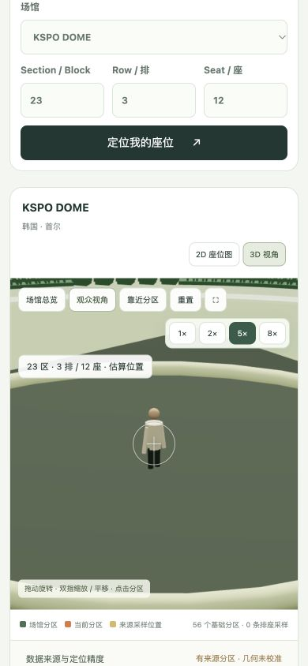

# SeatPeep 上线准备审计

日期：2026-10-24，Asia/Shanghai。审计对象为当前 `seatpeep` 源码、本地服务和场馆资料。本报告是工程发布判断，不是第三方安全认证或法律意见。

## 发布结论

**本地内测可继续；当前版本不通过正式公开、收费上线验收。**

用户最小需求是：从真实门票找到位置、了解距舞台的距离、预览不同倍率下表演者大小。当前实现可以探索分区、来源采样和模拟视角，但还不能可靠地兑现任意门票定位与真实距离承诺。即使去掉注册和收费，数据来源使用权限、产品准确性边界、正式部署和真机验收也仍需补齐。

## 本轮已修复

| 问题 | 原行为 | 修复及验证 |
| --- | --- | --- |
| 舞台距离使用错误场馆尺寸 | UI 调用 `performer(layout)` 未传场馆，回退到半径 24；三维相机使用当前场馆，两者不一致 | UI 和相机统一使用 `audienceSightline(venue, layout, position)`，共享眼高和表演者躯干目标；Tottenham 122/14/679 模型内距离 130.595，页面取整显示约 130m。仍非实测距离 |
| 无效排座强行落到边界座位 | 0、负数、超大编号、部分非法字符串会被夹到第一或最后排座 | 返回 null；不进入观众视角，距离显示 —；680、999999/999999 浏览器验收通过 |
| 将模拟结果称为票面已定位 | 无来源逐座坐标也显示“票面座位已定位” | 改为“模拟排座预览 · 票面位置未核实”；不允许保存成来源采样。数值处于模拟网格内仍只代表假定排座顺序，不代表真实门票编号 |
| 倍率与投影大小不符 | FOV 直接除倍率，轮滚/双指范围与按钮不一致，重新入座后按钮未复位 | 使用 `2×atan(tan(60°/2)/倍率)`；1—8×统一范围；重新入座复位；5×稳定 FOV 13.17°，8×8.26°；1×按钮恢复 |
| 手机控件重叠 | 390px 下倍率栏与位置标签垂直重叠 | 改为随内容换行的控件容器；320px、390px 无横向溢出，三组控件不重叠 |
| 中央舞台遮挡表演者 | 无真实依据的实体屏幕放在表演者原点，放大只能看到屏幕 | 去掉该示意屏幕；KSPO 23/3/12 中央舞台 5×截图已能看到人物 |
| 缺依赖锁文件与过时交付说明 | 没有 package-lock，README 仍引用旧测试数量和无变焦功能 | 补锁文件，更新当前验证和功能边界；历史测试记录保留历史属性 |

几何回归测试先观察到失败，再修复为通过；距离调用方另经真实浏览器核验。UI/CSS 和舞台遮挡以浏览器前后画面核验，不用源码字符串测试代替行为验证。

## 当前验证证据

- 完整 `npm test`：**65 tests / 65 pass / 0 fail**，最终日志见 [launch-tests-2026-10-24.log](launch-tests-2026-10-24.log)。使用临时数据库和回环端口，未发信、未付款。
- `node --check`：server/public/scripts 共 **21 个模块通过**。
- 生产配置冒烟：[launch-production-smoke-2026-10-24.json](launch-production-smoke-2026-10-24.json)。生产 HTTP APP_URL、开发收件箱、开发全馆权限、非 origin 的允许地址四类配置均被拒绝。健康接口 200、非法 Host 403、访客访问受限场馆 403；CSP、HSTS、禁止嵌套和 nosniff 头存在。传输为临时回环 HTTP，用于检查生产模式代码，**不代表真实 HTTPS 或反向代理已验收**。
- `npm audit --omit=dev --audit-level=moderate` 返回 0 vulnerabilities；本项目无 npm 外部依赖，因此不覆盖手工放在 vendor 的 Three.js r185 安全审计。MIT 许可文本已保留。
- 浏览器：Tottenham 122/14/679 匹配；122/14/680 不定位、不保存；超大票号不落到其他座位；KSPO 23/3/12 明确显示模拟预览；2D 显示 56 个分区且隐藏 canvas，切回 3D 正常；重新入座倍率回到1×。本次新验收页面读取的 warn/error 日志为空，只代表该页面采集范围。
- 390px：文档宽度390；320px：文档宽度320。当前测试是桌面浏览器窄视口，**不等于 iPhone/Android 真机性能或多指手势验收**。临时视口已复原。
- 本地服务恢复到 `http://127.0.0.1:4180`；同 Wi-Fi 为 `http://192.168.6.150:4180`。电脑需保持运行，网络变化后地址需重新确认。

## 正式上线阻塞项

| 级别 | 阻塞项 | 当前证据与通过条件 |
| --- | --- | --- |
| P1，核心承诺 | 真实票号到位置的映射不完整，米制未校准 | 197馆完整逐座库存为0，米制校准为0；1,798条三馆来源采样是离散记录。至少先选少数首发馆完成票号映射、坐标配准、抽样对照和误差验收；其余馆仅提供清楚标识的分区/模拟探索，不能宣传为真实票面定位 |
| P1，核心承诺 | 演出舞台位置及可售封区未校准 | 当前三类通用舞台不代表真实演出；选择演出只显示来源/参考图状态，不自动得到真实三维布局。首发场次需取得有依据的舞台几何并验证距离；不得把票务参考图当已校准模型 |
| P1，公开发布 | 场馆数据、热区和参考站资料缺商用使用权限记录 | 当前仓库有公开来源证据，没有可确认适用的商用再分发授权记录。按来源补许可证、授权或独立制作依据，并对发布数据逐项记录；REA采集成功不能证明有发布权或数据准确 |
| P1，正式收费 | 生产账号与订阅无法走通 | 未配置 Google/Resend/Stripe；生产冒烟全部 provider=false，除 Tottenham 外访客仍被锁定。本地全馆和模拟升级在生产被禁止。收费版本需真实注册、恢复登录、付款、Webhook、取消与到期全链路验收；纯匿名预览版可以不启用这些商业流程 |
| P1，部署 | 域名、HTTPS、反代、持久化与恢复未验收 | 仓库没有已验收的正式部署记录。需真实域名和TLS、仅代理可访问应用端口、持久卷、SQLite一致性备份及恢复演练、进程重启、健康与错误监控、回滚步骤。当前SQLite设计应按单实例部署 |
| P1，反代可用性 | 限流以连接对端IP计数，反代后可能所有人共用配额 | `server/app.mjs` 以 `req.socket.remoteAddress` 为HTTP/邮件IP限流键。需明确可信代理边界，并在边缘正确按客户端限流或实现受信代理解析，再用两个不同客户端验证；不能直接信任任意 X-Forwarded-For |
| P1，移动端发布验收 | 真机流畅度、内存和 WebGL 失败恢复缺证据 | 两档椅子网格都按全场分配，切换主要改变可见性；大馆仍有内存风险。需 iOS Safari/Android Chrome 实测连续拖动、捏合、切馆、前后台、内存和上下文丢失。已有错误提示/初始化降级代码，本轮未注入WebGL失败，不标为已验收 |
| P2，面向欧美 | 英文体验和用户服务资料不完整 | 当前主要中文；隐私说明、服务条款、联系/数据纠错和账号删除路径未成套落地。启用欧美账号/付费前补齐实际运营主体、处理方式与相关入口，并核验适用要求 |

## 功能边界

1. 2D 是分区轮廓和来源视点热区；不是完整逐座平面图，没有完整缩放/平移交互。3D和2D仍有来源屏幕坐标与估算XYZ两套坐标系。
2. 3D绿色椅子可点击探索，默认排座密度和编号是假设；不能据此证明真实门票位置。来源采样的票号匹配也不证明其XYZ已实测。
3. 放大比例现在符合当前透视相机中的投影倍率；基准是60°垂直视野，不是某款手机24mm镜头的校准结果。真实镜头、画幅、裁切和拍摄效果尚未模拟。
4. 人物是约1.74m的示意模型。真实看到多大仍依赖场馆尺度、舞台、眼高、人物高度和镜头视野准确。
5. 本轮没有逐一浏览197馆的每个分区，不把少数浏览器用例等同于全馆视觉验收。

## 最小发布顺序

先收敛首发场馆和场次，把数据使用依据、票号/几何误差和可展示范围验收清楚；再完成真机与WebGL验收、可信反代限流及部署备份恢复。若先发免费预览，页面和宣传必须与分区/模拟探索能力一致；若发付费版，再增加真实账号和Stripe全流程验收。以上证据齐备后重新做Go/No-Go判断，当前不部署。

## 本轮手机截图

中央舞台5×，表演者可见，控件不重叠；这张图证明展示修复，不证明真实场馆精度。

