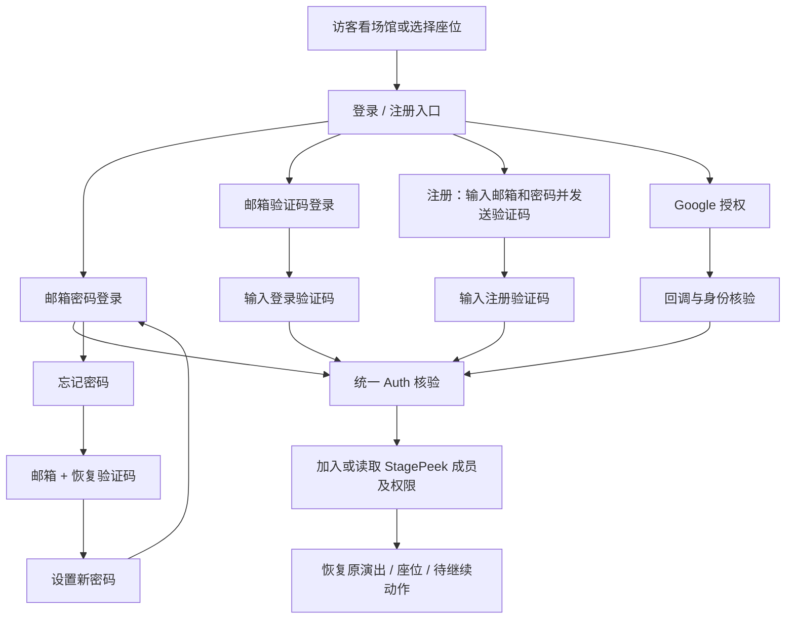

# StagePeek 账号流程与页面设计

日期：2026-10-26。状态：用户已批准实施；原始预检与设计保留，实际完成/上线证据见 [验收记录](../../operations/auth-flows-2026-10-26.md)。

## 1. 目标、范围与方案

让用户能清楚完成注册、登录、找回密码、Google 登录，并回到原先正在看的演出和座位。统一使用现有 Supabase Auth、StagePeek 品牌邮件和业务 PG/RLS，不增加第二套身份系统。

用户已确认方案 B 并授权实施。以下预检是实现前快照，不代表当前代码状态；真实发信仍需独立授权。

| 方案 | 用户体验与取舍 | 本稿意见 |
| --- | --- | --- |
| A：邮箱验证码 + Google | 最少步骤，不需要密码；对应帮助入口应叫“无法登录”，没有真正的密码找回 | 适合极简产品，但不覆盖用户提出的完整密码流程 |
| B：邮箱密码 + 邮箱验证码 + Google | 覆盖四种流程；已有无密码用户继续可用，需要补密码设置、恢复与账号安全页面 | 用户已批准，按此实施 |

用户本轮明确修订邮箱注册顺序：先输入邮箱和密码，再发送注册验证码；验证成功后直接回到原页面，不再追加设置密码步骤。密码不是访客浏览免费场馆的前置条件。首次 Google 登录仍不强制设密码、不强制填昵称。注册是加入 StagePeek 的产品动作；平台上已有共享身份不代表已有本站成员或付费权限。

## 2. 代码预检 findings

以下严重性针对“完整四种账号流程”的交付，不代表现有 OTP 全部不可用。行号对应本次核查工作区。

| 编号 / 严重性 | 类型与位置 | 触发、影响、建议、状态 |
| --- | --- | --- |
| F1 / P1 | 未实现：`server/supabase-auth.mjs:51`、`:59` | 只有 OTP 申请/验证，没有密码登录或密码管理；不能把现有入口描述成密码登录。建议补统一 Auth 密码能力。待实现 |
| F2 / P1 | 未实现：`public/auth-page.mjs:7` | `/auth/reset` 仅隐藏表单并说明“无需重置密码”，用户不能找回密码。建议替换成完整恢复状态机，邮件 recovery 同步开放。待实现 |
| F3 / P1 | 未实现 + 配置缺失：`server/app.mjs:74`、`:97` | shared 模式 Google 强制关闭，非仅缺一个按钮；需共享 OAuth、PKCE 回调、Google 控制台配置及账号关联。待实现/配置 |
| F4 / P2 | 代码缺陷：`public/auth-page.mjs:22` | 独立验证页成功后固定回首页，丢失演出/座位和发起动作。建议可信 returnTo + 可恢复上下文。待修复 |
| F5 / P2 | 页面缺口：`public/index.html:66`、`:69` | 当前只有合并 OTP 弹窗和简易账号弹窗，未覆盖密码、账号安全、完整条款入口；Google 未就绪仍展示禁用按钮。建议统一账号壳层与能力开关。待设计实现 |
| F6 / P1 | 外部服务未验收：`docs/operations/shared-auth-rollout.md:31` 起的生产记录 | 邮件基础设施和公网边界验证不等于真实收件、验证码一次性消费通过。发布完整账号流程前需授权邮箱端到端验收。待验收 |

现有优点继续保留：首次 OTP 验证加入普通成员；身份在线核实；邮箱与 IP 限流；HttpOnly 加密 Cookie；逐用户/逐项目 RLS；管理员角色不取自前端或用户 metadata。

## 3. 页面与入口

桌面维持深色演唱会风格：品牌 Logo、清晰标题、短说明、表单、主按钮、替代方式、条款。手机使用单列全屏账号页，保留返回按钮，不在键盘上方堆叠无关介绍。

首页右上角“登录 / 注册”；收藏、付费场馆、升级订阅也可打开同一账号流程。访客仍可浏览已配置的免费场馆，不强制注册。

| 页面 / 建议路由（尚未全部存在） | 必须展示 |
| --- | --- |
| 登录 `/auth/login` | 标题“登录 StagePeek”；邮箱；密码与显示/隐藏；“登录”；“忘记密码？”；“使用邮箱验证码”；Google 按钮（就绪才显示）；“还没有账号？注册”；条款/隐私 |
| 注册 `/auth/register` | 标题“创建 StagePeek 账号”；“保存位置，随时回来看现场视角”；邮箱、密码、显示/隐藏及密码规则；“注册并发送验证码”；Google；“已有账号？登录”；明确的条款/隐私同意文案和链接 |
| 验证 `/auth/verify` | 标题随用途变化；脱敏目标邮箱 + 修改邮箱；单个验证码输入框；“验证并继续”；重发倒计时；返回；收不到邮件帮助 |
| 设置密码 `/auth/password` | 用于已有无密码账号的独立账号安全操作，不属于邮箱注册流程；新密码、确认密码、显示/隐藏、规则、统一账号影响提示；“确认设置密码” |
| 找回 `/auth/reset` | 三步：邮箱 → 恢复验证码 → 新密码；进度说明；返回登录；完成后“密码已更新，请重新登录” |
| Google 回调 `/auth/google/callback` | “正在完成 Google 登录…”；失败/取消的明确提示；返回登录；不展示 code/token 原文 |
| 账号 `/account` | 邮箱、验证状态、登录方式、密码管理、套餐/到期、订阅管理、已存位置、退出；危险动作与浏览功能分区 |

登录弹窗与独立页面复用同一组件和状态机；回调、刷新、复制地址后不能出现另一套行为。认证页 noindex，不进 sitemap。页面 zh-CN/en 文案对应邮件语言；Google 需保留其品牌按钮规范。

布局示意（不是已实现页面）：

```text
[StagePeek]                       [关闭 / 返回]
登录 StagePeek
继续查看你刚才选择的现场位置
[使用 Google 登录]                ← provider 就绪才显示
---------------- 或 ----------------
邮箱地址 [                         ]
密码     [                    显示 ]
                         忘记密码？
[             登录                ]
使用邮箱验证码
还没有账号？注册
服务条款 · 隐私政策
```

## 4. 流程总览



### 4.1 注册

1. 用户从注册页填写邮箱和密码，阅读并确认条款/隐私，点击“注册并发送验证码”。提交前展示并校验密码规则，不要求手机号、生日、信用卡。
2. 服务端通过统一 Supabase Auth 的邮箱密码注册能力提交凭据并触发注册验证码，不再以普通登录 OTP 请求代替密码注册。密码不存业务库、Cookie、URL、localStorage 或日志；进入验证码步骤后清空页面密码输入，后续验证不要求重新填写。显示“请检查邮箱，输入验证码以完成注册”；仅收到发送系统确认后显示成功，不等同保证投递到收件箱。
3. 邮件展示 StagePeek 标识、注册用途、验证码、有效期和非本人操作说明；没有认证链接或按钮。
4. 服务端核验用途、浏览器 pending 与验证码。只有验证后的身份才能加入本站普通成员；不在发码时授予权限。
5. 验证成功即完成注册并建立登录状态，直接回原演出/座位/页面，不再要求设置密码或选择“稍后设置”。不自动开订阅，不因注册解锁付费场馆。
6. 既有共享身份或本站账号再次进入注册时，不覆盖已有密码、不创建重复账号；提供登录或找回密码入口，未验证前不泄露邮箱是否已注册。对既有 OTP/Google 用户添加密码属于独立的已验证账号安全操作，不从注册重试中隐式执行。

兼容现状：当前生产普通 OTP 允许首次创建共享身份，这是现状而非新的邮箱密码注册实现。目标版本保留已有无密码用户的 OTP 登录能力，新邮箱按本节的邮箱密码注册流程进入。条款版本和接受时间仅记录本站必要业务信息；营销订阅单独选择且默认不勾选。

### 4.2 登录

**密码方式：** 邮箱 + 密码 → Supabase 校验 → 本站成员/权限 → 回原位置。失败统一“邮箱或密码不正确”，不分别泄露账号是否存在。不锁定用户使用验证码备用入口。

**验证码方式：** 点击“使用邮箱验证码” → 邮箱 → 发码 → 输入 → 同一身份核验 → 回原位置。目标版本用于已有账号（包括已有无密码用户）；不再把登录 OTP 默认自动创建身份作为新邮箱注册通路。入口同时提供“没有账号？注册”，并采用不泄露邮箱存在性的响应和提示。已有共享身份首次加入本站仍走统一条款门禁。

邮箱未确认、账号禁用、请求限流、网络故障分别映射为可行动提示，但不返回平台内部信息。密码用户不应每次登录都收邮件。

成功返回后刷新套餐/收藏/场馆权限，不重复创建项目用户。取消登录回到原画面，原选座状态保留。

### 4.3 找回密码

1. “忘记密码？”进入邮箱页，标题“找回密码”。提交后统一“如果该邮箱可以恢复账号，你会收到验证码”，不提供账号存在性查询。
2. 申请 **recovery** 用途验证码；邮件与页面都明确“重置密码”。不使用普通登录验证码冒充 recovery，不自动为未知邮箱注册。
3. 输入恢复验证码，由统一 Auth 校验；BFF 只在服务器持有恢复凭据，并签发短时、单次、绑定邮箱/用户/用途的恢复流程状态。
4. 此时前端仍停留恢复流程，不当成普通登录成功，不开放收藏、账单或账号设置；避免恢复会话成为旁路登录入口。
5. 显示新密码 + 确认密码。页面提示“你正在修改统一账号密码；同一账号在其他平台产品的密码登录也会使用新密码”。不修改 Google 账号的密码。
6. 更新成功才显示“密码已更新，请重新登录”；清除恢复状态和本站旧 Cookie，回登录页，仅预填邮箱。中途失败可在有效恢复状态内重试，不显示虚假的成功。
7. 撤销共享身份的其他 refresh 会话属于跨产品影响：建议恢复时执行，并在提交前明确“其他设备及使用同一账号的产品可能需要重新登录”。实施前验证共享服务实际撤销语义，不声称已签发 JWT 瞬间失效。

OTP/Google-only 用户：邮箱验证后可以显式选择“设置统一账号密码”，不要求不存在的旧密码；不能仅凭已登录普通 Cookie 直接设置或覆盖密码。Google OAuth 自身的账号恢复仍由 Google 负责。

恢复流程仅在消费页、品牌 recovery 模板、中央登记和真实验收都完成后开放；当前 `/auth/reset` 说明页不算此能力。

### 4.4 Google 登录 / 注册

1. 已就绪时展示“使用 Google 登录”，注册页同样支持；不要求先填邮箱。未配置或健康检查不通过时隐藏，避免按钮能点却不能用。
2. 发起时服务端绑定 returnTo、PKCE verifier、短时 state/nonce（按选定 OAuth/OIDC 模式）；使用 Google → **共享 Supabase callback** → StagePeek 项目 callback 的正确链路。不能把两种 callback URL 混填。
3. 使用顶层跳转兼容手机和弹窗拦截；Google 页面选择账号、授权。仅申请身份所需权限，不申请通讯录/网盘等业务无关范围。
4. 回调校验流程与统一 Auth 身份。首次加入本站建立普通 member；已有身份读取原成员。获取邮箱必须满足共享身份验证策略，不信任浏览器提交的 profile。
5. 新本站成员首次进入展示条款/隐私确认，未接受不执行收藏、订阅等本站写操作；保留已经生成的身份而不谎称其从未创建。
6. 成功回原位置。拒绝/取消提示“已取消 Google 登录，你可以使用邮箱继续”；网络失败保留重试；state 不匹配/过期要求重新发起，不使用回调参数补建会话。

账号页根据统一 Auth 可信身份信息显示“Google 已连接”。不能因为用户本次从 Google 进入，就判断其没有密码：同一共享账号可能已经在其他产品设置过密码。没有可信的中央凭据状态时，统一显示“设置或更改统一账号密码”，经新近邮箱验证后操作；不新增仅为判断密码有无的管理接口，也不把本站记录当作共享密码状态。

## 5. 账号关联、权限及共享边界

- 业务关联主键是可信 Supabase user ID + site ID，不是邮箱字符串。相同邮箱身份关联由 Supabase 的已验证身份规则处理；上线前在当前自托管版本验证，不能自写“同邮箱就合并”SQL。
- 已有付费用户改用 Google 后，应保持同一 Auth UID，套餐和收藏不变；自动关联不成功时让用户回原方式登录后处理，不能新建用户并复制权益。
- 不同 Google 邮箱默认是不同账号；MVP 不做跨邮箱账号合并。可在已登录且新近验证后使用统一 Auth 的显式 identity linking，但需独立实现与测试，不能混同登录按钮。
- MVP 不提供解绑最后一种登录方式、不自动迁移订阅、不根据 Google email/name/metadata 授予 admin。
- 账号页不暴露其他平台产品的成员数据。修改共享身份密码/撤销共享会话的影响明确告知；StagePeek 的免费名单、付费权限、管理员角色继续独立。
- 老 OTP 用户无须批量迁移或重建账号；不设默认密码。Google 未接通之前不显示“已连接”。

账号安全页的“设置 / 修改密码”也必须经过新近邮箱验证；普通登录会话不等于可以修改统一身份凭据。新近验证的有效期、单次用途和浏览器绑定由服务器控制，不能由前端传 `verified=true`。

条款确认是所有认证方式共用的本站入站门禁：不论密码、OTP 或 Google，只要首次加入本站、历史成员缺少记录或版本需要更新，都在业务写操作前展示确认。身份验证可以先成功，仍允许浏览免费场馆；未接受时不执行收藏、checkout 或后台写操作，账号安全及退出仍可用。条款版本与接受时间按本站成员保存，由服务器检查；已接受当前版本不重复拦截，不根据 Google profile 决定。此次不追溯伪造历史接受记录。

## 6. 通用页面状态与交互

| 状态 | 页面展示与动作 |
| --- | --- |
| 空表单/格式错误 | 字段下明确提示；邮箱输入用 autocomplete=email；密码允许粘贴和密码管理器 |
| 请求中 | 按钮变“正在发送 / 登录 / 验证…”并防重复；页面可返回，网络超时提供重试 |
| 发码成功 | 脱敏邮箱、用途、单框数字验证码；允许整段粘贴、one-time-code 自动填充 |
| 重发 | 默认至少 60 秒倒计时，最终依据服务端 retryAfter；前端倒计时不是安全限流 |
| 错码/过期/已使用 | “验证码错误或已过期，请重新获取”；留在流程内，不泄露正确码或详细内部错误 |
| 修改邮箱 | 清除旧输入及服务器 pending；旧流程不能继续用于新邮箱；不得绕过发码频率限制 |
| 限流 | 展示可重试时间；后端按 IP/身份/动作限流，避免恢复接口成为免费发信代理 |
| 收不到邮件 | 检查邮箱拼写/垃圾邮件、等待后重发；不承诺固定秒数送达，不建议无限点击 |
| 服务故障 | “登录服务暂不可用，请稍后重试”；不把故障当密码错误，不清除仍合法会话 |
| 会话过期 | 说明需要重新登录，保留选座；禁用重复付款/自动执行敏感动作 |

密码规则建议至少 12 字符、允许长密码和密码管理器，不强制复杂符号组合；具体上限及规则须与共享服务配置一致，不能只做前端校验。autocomplete 登录用 current-password，设置/恢复用 new-password。

所有表单有 label、键盘顺序、错误关联、aria-live；成功和失败不只靠颜色。对话框聚焦/回焦正确；手机不横向溢出。条款与隐私必须有真实可访问页面，未编写不能用空链接充数。

## 7. 登录后返回与待继续动作

发起前保存 `{venue,event,layout,section,row,seat,viewMode,zoom,intent}` 的必要非敏感状态。returnTo 只接受本站允许的相对路径，拒绝外域、`//`、反斜杠、控制字符以及认证循环地址；以服务器白名单验证为准。OAuth return context 不能当任意跳转代理。

- 普通登录：回原场馆/演出/选座和视角，不统一送首页。
- 收藏触发：恢复目标后说明“已登录，继续保存此位置”，只提交一次并校验服务端额度；不执行旧标签页中另一座位的动作。
- 付费场馆触发：登录后有权限才开放，否则展示升级，不把登录当付费成功。
- 升级触发：登录后回订阅确认页，重新点击购买；不自动跳外部付款或重复扣款。
- 找回结束：先回登录；密码登录完成后再恢复原位置。
- 不存在的场馆/过期演出/已下架座位：回可用场馆页并解释，不落入空白画面。

认证 token、密码、验证码、Cookie 不放 URL、localStorage、分析事件或日志；回调 code 立即消费并从地址清理。语言只取允许值，邮件和页面保持一致。

## 8. 实施边界与顺序

1. 统一 Auth 页面壳、能力开关、可信返回状态；保留现有 OTP 通路。
2. 邮箱密码注册 → 注册验证码消费 → 自动登录回原页，以及密码登录和独立账号安全操作；密码只交给统一 Auth，不存业务表或日志。
3. recovery 申请/消费/短时上下文/更新密码/会话处理，随后才启用中央品牌邮件 recovery。
4. 共享 Google provider 和 Google 控制台配置、PKCE callback、取消/异常/身份关联；不复用生产已停用的自有 OAuth 路径。
5. 真实授权邮箱及测试 Google 账号验证；灰度发布，保留 OTP 回退入口。回滚关闭新增入口但不删共享身份、成员、收藏或订阅，也不退回自建 Auth。

现有 `/api/auth/email`、`/api/auth/email/verify`、`/api/auth/logout` 保留兼容；新接口需区分 password login、password setup、recovery start/verify/complete、Google start/callback。接口名在实施计划中定稿，不能因前端传入 `flow=recovery` 就授予恢复权限。

## 9. 验收清单（目标，尚未执行）

- [ ] 新邮箱注册：先填邮箱和密码再发码；验证码一次性消费后自动登录回原页；无注册后设置密码步骤；普通 member、条款记录；未验证无业务权限。
- [ ] 既有 OTP/Google 用户不重建身份；注册入口不会覆盖已有密码；设置密码要求新近验证。
- [ ] 正确密码成功；错误密码/未知邮箱等价提示；长密码/粘贴/移动端可用。
- [ ] OTP 登录、注册、恢复用途不可互换；重发/换邮箱/过期/旧码/重放/并行提交行为经过真实服务验证。
- [ ] 恢复码成功后不提前产生可访问业务的普通会话；更新密码后旧密码失败，新密码成功。
- [ ] 恢复中刷新/超时/更新失败可恢复；没有恢复上下文不能直接改密码。
- [ ] Google 新用户、老用户、相同已验证邮箱、不同邮箱、取消/拒绝/坏 state/PKCE 失败均有测试。
- [ ] 同一 Auth UID 的付费权限和收藏跨登录方式保持；跨用户/跨项目不可读取；无管理员提升。
- [ ] 免费场馆仍为后台配置的 10 个；登录不解锁付费；未登录/越权请求仍拒绝。
- [ ] 从首页、场馆、收藏、付费页发起均正确回跳；恶意 returnTo 被拒绝；不自动扣款。
- [ ] 账号页准确显示方式、邮箱和套餐；退出清本站状态；共享会话撤销边界文案与实际一致。
- [ ] 真实邮箱收件 From/品牌/语言/用途/有效期匹配，无认证链接；真实 OTP 消费成功且不能重放。
- [ ] 生产无本地模拟入口，无前端服务密钥；认证页 noindex；日志/分析无验证码/密码/会话。

## 10. 依据与未定项

当前事实以 [统一 Auth 发布记录](../../operations/shared-auth-rollout.md) 与本次代码核查为准；旧部署 Skill 的日期快照不代表当前生产状态。

官方参考（2026-10-26 核对）：[邮箱与口令认证](https://supabase.com/docs/guides/auth/passwords)、[验证码类型](https://supabase.com/docs/reference/javascript/auth-verifyotp)、[身份关联](https://supabase.com/docs/guides/auth/auth-identity-linking)、[Google 接入](https://supabase.com/docs/guides/auth/social-sign-in/auth-google)。这些文档说明统一服务能力；本稿页面、顺序及文案是 StagePeek 的设计建议，不是官方默认行为或现有已实现功能。自托管版本/config、验证码有效期、密码规则、recovery 会话撤销和 Google 关联须在实施时实测。

已确认采用方案 B；邮箱注册顺序按用户修订实施。Google 外部凭据和真实邮箱收件验收按事实单独记录。
