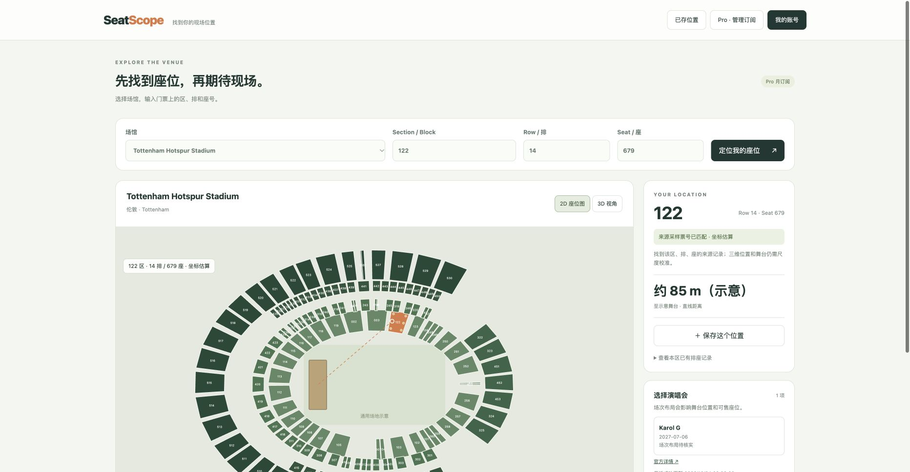
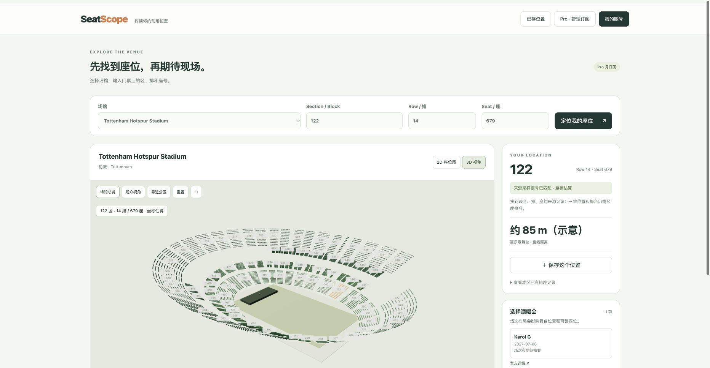
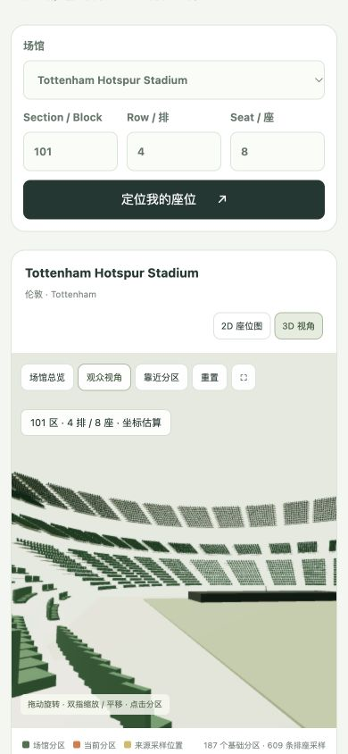
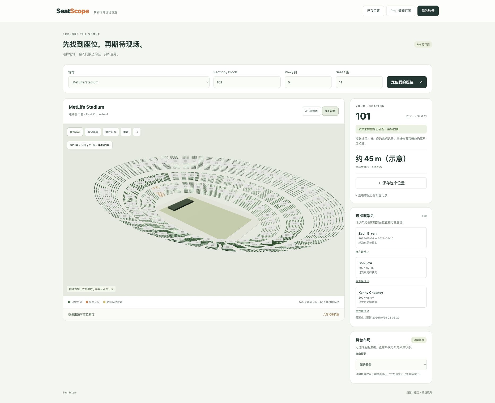
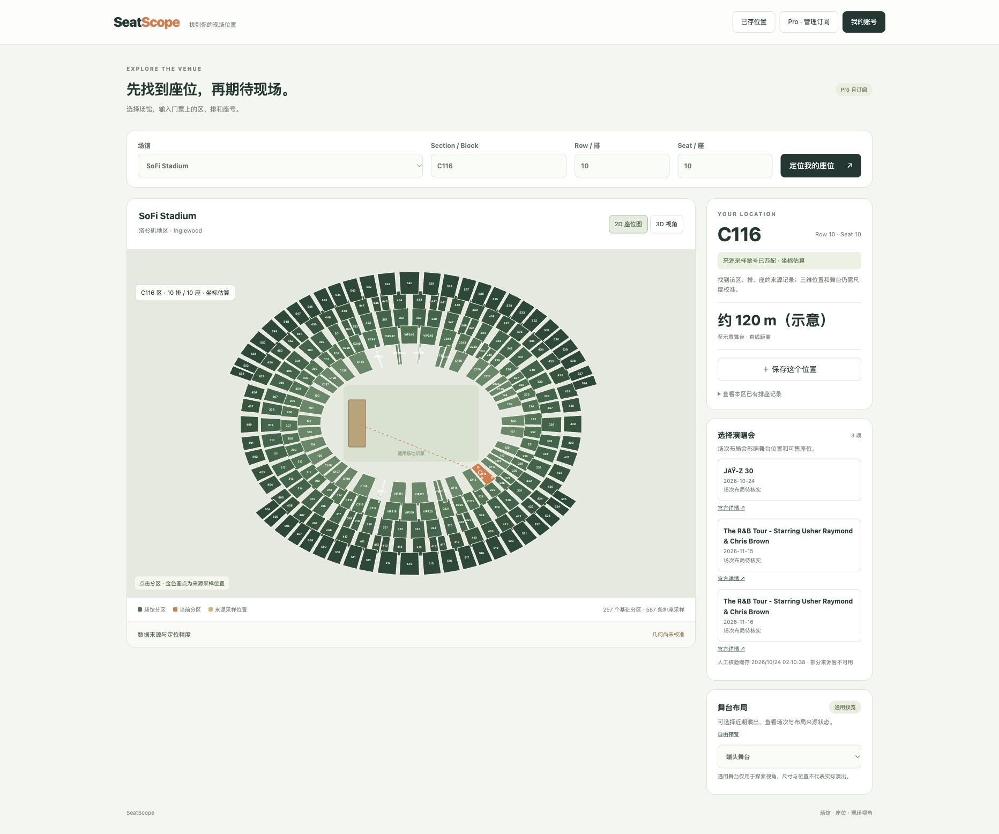
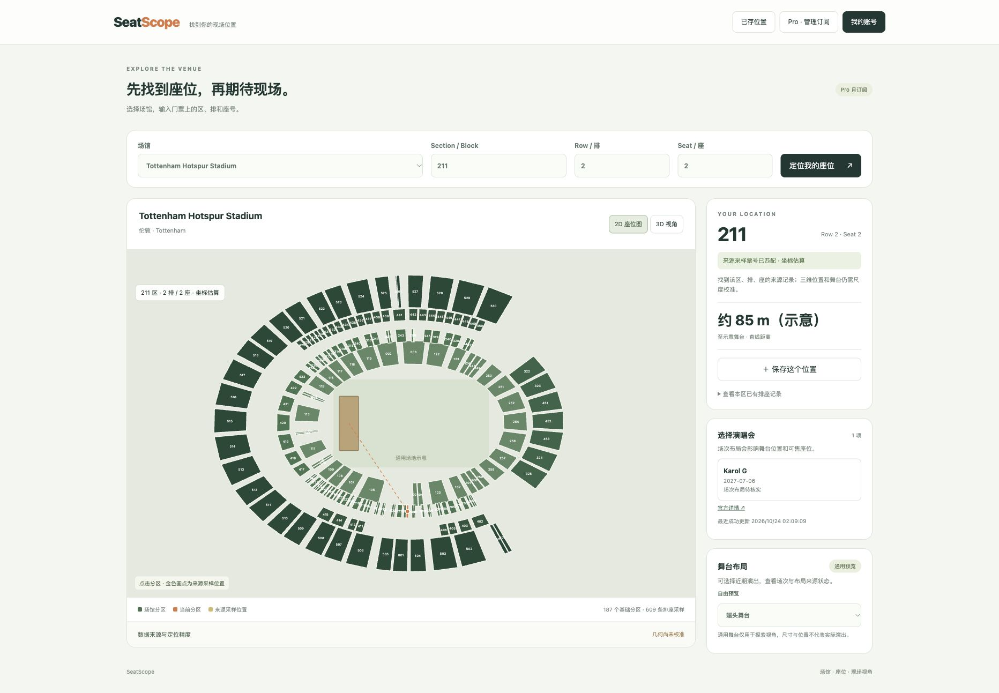
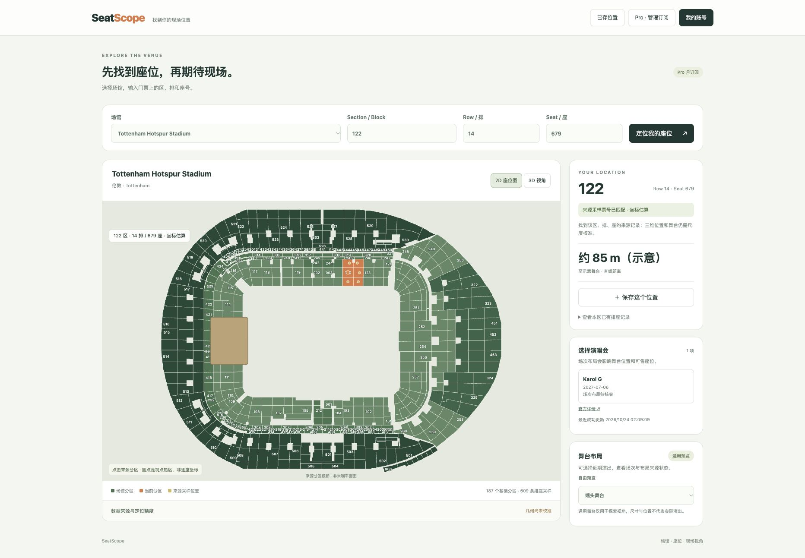
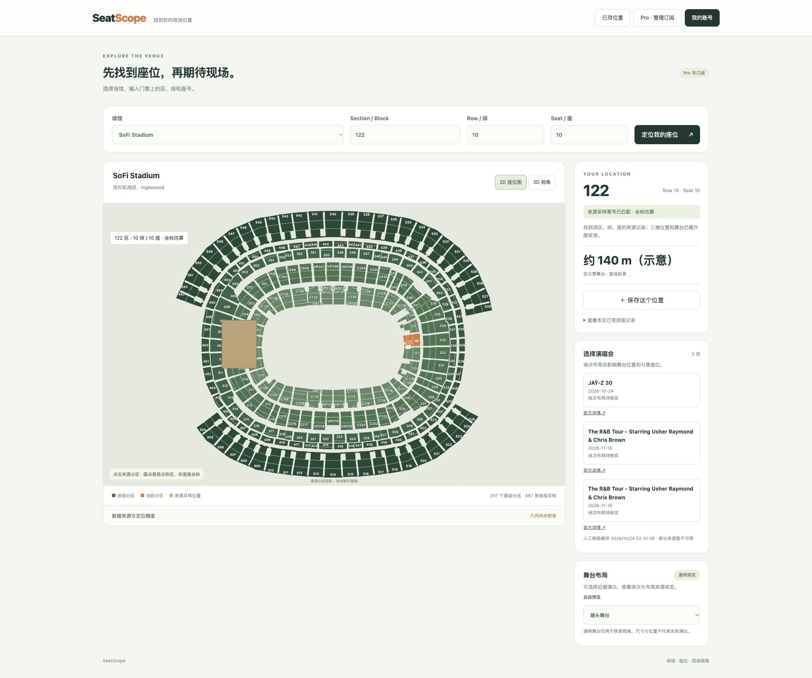

# 本地验证记录

> 最新复查：2026-10-24完整测试65/65；本地内测可继续，正式公开/收费上线未通过。见[上线准备审计](launch-readiness-2026-10-24.md)。下文测试数量为此前历史记录；当前支持明确标识的模拟排座预览和1—8×视角放大，无效排座不会夹到其他位置。

日期：2026-10-24（Asia/Shanghai）；Node v26.5.0。范围是本地可测试交付，不是生产验收。

## 自动测试

命令 `npm test`：**52 tests / 52 pass / 0 fail**。HTTP 测试使用临时回环端口；SQLite 使用内存或临时文件；Google、邮件、Stripe 使用受控协议应答，未发送真实邮件或发起实际付款。

覆盖：单次邮箱凭证、过期与重放、浏览器绑定、持久会话与退出、Google state/PKCE/verified email及账号关联、访客/免费/Pro/过期/取消到期权限、受保护场馆API和静态路径隔离、Stripe月价校验、签名Webhook/重放/乱序/price/customer、Checkout并发/跨十分钟窗口/重启复用、上游订阅先于Webhook生效的重复付款限制、本地测试数据隔离、已知/未知票号和2D3D共享坐标、官方演出日期/取消/缓存/抓取失败。

修复用例均观察了失败后再修复成功。此前独立整体审查的历史快照为 37/37；之后新增了来源热区和公开场次座位图参考测试，当前完整套件为 52/52。独立整体审查及三个问题的回归见 [final-review.md](final-review.md)。

## 实际浏览器

Chrome，真实运行的 `http://127.0.0.1:4180`：

- 本地预览模式载入 Tottenham；场馆 API 返回197个目录项，当前本地预览访客可直接打开全部197馆，生产模式仍只给访客 Tottenham。
- `pro@seatpeep.test` 经邮箱申请、测试收件箱链接、确认登录，页面显示 Pro 并解锁全部197个场馆；重载和服务重启后会话仍有效。Wembley 显示25个官方锚点和0条排座采样。
- 保存 Tottenham 122 / 14 / 679，在“已存位置”读取成功。
- 输入 122 / 14 / 680，显示未核实，保存与观众视角禁用；改回679恢复匹配。
- 修复 SVG `hidden` 属性未移除导致2D不显示：复现不可见，修复后可见，187个分区交互目标存在。
- 3D点击分区、靠近、观众视角、拖动；移除绘制用点击代理后仍实际点击到101区。
- SoFi显示3项人工核验的官方演出及人工缓存状态，保留自动抓取不可用说明。
- 新增官方关联采样接入后，MetLife显示146个基础分区、602条采样；203A / 6 / 11实际匹配，二维有146个交互分区。
- SoFi显示257个基础标识、587条采样；C116 / 10 / 10实际匹配，二维有257个交互分区。改成Seat9999显示未核实、保存和观众视角禁用；恢复Seat10重新匹配。三维实际建立257区、37,008把示意椅子。
- 手机尺寸 **390 × 844 CSS px**：文档宽390，无横向溢出，画布364 × 420；3D显示、观众视角和鼠标模拟拖动可用。已恢复原浏览器视口。

**未进行真实手机硬件、Safari、Android WebView、多点触摸或低端GPU测量。** 窄屏和鼠标模拟不等于真实手机触控验收。

浏览器日志出现一次 `chrome-extension://…/inpage.js` 的 `sseError not found`，来源是扩展；未观察到该条由本应用脚本抛出。不能将其写成应用零错误证明。

## Tottenham 分层图方向修复

导入程序原先只读取FullStadium总览，33个仅出现在分层图的基础标识缺失方位，并静默使用角度0。29个Level2 Sideline Suite因此重叠。本轮用与总览共享view中心对齐的Level200/Level500同相机数据补方位；缺失方向现在直接报错，不再回退到0。29套房有29个不同角度，900号Broadcast Booths归入来源高层。几何仍estimated、metricCalibrated=false。

新增测试先观察到1个角度而非29个，修复后通过；完整52/52通过。沙箱首次执行中8项HTTP测试因 listen EPERM 未能运行；使用允许回环端口的本地执行后52项全过。

重建数据并重启服务后，Chrome二维实际依次点击201、211、231、900均匹配不同位置；201/211/231中心分别为(48.065,59.448)、(-2.738,67.974)、(-76.570,43.104)。900三维靠近时相机高度76.5，与估算高层中心41.5相符。122/14/679仍匹配且保存、读取成功。截图见下方。此验证证明导入错误修复，不证明套房尺寸、完整座位或距离准确。

## 绘制开销

同一390px视口、Tottenham初始总览：渲染器报告26,928个示意椅子实例、187区。未显示的点击检测网格原先参与渲染，修复后 `drawCalls` **430 → 56**，已上传几何数 **202 → 15**。该数字只是相同视角的绘制计数，不是FPS、内存占用或真机续航结论。

新增SoFi数据后，390×844视口：文档宽390、画布宽364，无横向溢出；257区、37,008把示意椅子，总览报告74次绘制调用。该场馆更完整的覆盖未引入逐座独立draw call；仍未测真实手机帧率，临时视口已恢复。

## 可访问路径

`npm run start:local` 已运行，服务绑定 `0.0.0.0:4180`。

- `http://127.0.0.1:4180/api/health` → HTTP200。
- `http://192.168.6.150:4180/api/health` → HTTP200。
- 对应 `/api/me` 分别报告 `localInbox=true` 和 `false`，回环收件箱限制生效。
- 未在另一台真实手机发请求；同Wi-Fi客户端仍取决于本机网络和防火墙状态。

## 演出来源实测

Tottenham 和 MetLife 使用真实官网 HTML 自动刷新，缓存保存来源、尝试时间、成功时间及失败记录。

| 场馆 | 展示的演出 | 日期 | 取得方式 |
| --- | --- | --- | --- |
| Tottenham | Karol G | 2027-07-06 | 自动官方详情 |
| MetLife | Zach Bryan | 2027-05-14—15 | 自动官方详情 |
| MetLife | Bon Jovi | 2027-07-15 | 自动官方详情 |
| MetLife | Kenny Chesney | 2027-08-07 | 自动官方详情 |
| SoFi | JAŸ-Z 30 | 2026-10-24 | 官方详情人工核验 |
| SoFi | Usher Raymond & Chris Brown | 2026-11-15、16 | 两份官方详情人工核验 |

SoFi本机自动fetch失败，未关闭TLS验证。人工核验页面：[JAŸ-Z](https://www.sofistadium.com/events/detail/jay-z-october-24-2026)、[11月15日](https://www.sofistadium.com/events/detail/chris-brown-usher-november-15)、[11月16日](https://www.sofistadium.com/events/detail/chris-brown-usher-november-16)。缓存标记 `manual-official-page-verification`，日期及官网本地时间分开保存，没有伪造成抓取成功的HTML或已确认舞台图。

本轮继续顺官网Buy Tickets真实链接追场次布局：Zach Bryan的场馆链接先到Ticketmaster艺人/场馆页，再到 [2027-05-14具体场次](https://www.ticketmaster.com/zach-bryan-east-rutherford-new-jersey-05-14-2027/event/0000654CE2BEAC96)；SoFi同样到 [Usher/Chris Brown 2026-11-15场次](https://www.ticketmaster.com/the-rb-tour-starring-usher-raymond-inglewood-california-11-15-2026/event/0A006494C5CE878D)。web读取只取得演出资料/加载框架，未取得舞台图；本机curl两页均HTTP401，实际Chrome的SoFi场次只到“Almost there. Don't refresh the page...”等待页。Karol G官网票务链接则进入eticketing排队页，web不可读取。未绕过排队/验证、未登录购票，也没有把艺人通用图片当舞台图。当前证据仍不足以为这三场选择真实舞台布局。

MetLife Bon Jovi 的官网JSON-LD存在1969年的结束时间，程序现在忽略早于开始时间的结束字段，避免未来演出被当作历史。橄榄球和USBands比赛已排除。对其他未确认音乐类型的通用Event，仍需进一步分类核验。抓取未穷尽所有分页，不承诺官网演出全量。

## 数据与授权尚缺项

- 原站场馆批量导入已完成：193个去重目录场馆生成导入包，产品目录共197馆；104馆有分区参考，59馆只有几何参考，30馆只有目录级示意标签，7馆保留少量公开座位资产样本。导入审计见 `docs/shijiao-import-report.json`。

- 三馆均无完整逐座清单与已校准米制XYZ；已接入Tottenham609、MetLife602、SoFi587条可用排座采样，共1,798条。每条通过服务端精确匹配及共享渲染位置检查；这不代表全座位或现场坐标准确。
- 所有场次舞台/封区布局未核实，展示通用探索模板。
- 没有实际完成Google、Resend、Stripe端到端连接；按钮在缺配置时不提供伪成功。
- 公开来源未证明开放商用授权，正式发布前仍需取得适用授权和校准证据。
- REA正式MCP已在重启后可用，既有原站正式采集证据 `ev_1f87574d159d170f4c5cad6ff7216e4cec76c521e7987993869b76591d156cd0`；这不能证明本项目座位坐标准确。此前9222代理限制已不再阻碍既有分析，不需要用户再改浏览器配置。

## 截图

新增官方关联分区及采样数据后的效果：

## 公开二维热区接入

数据构建现在保留每个场馆官方关联 Virtual Venue 的 FullStadium / 对应层 `Aerial_Camera_Overview` 热区，二维图按来源顶点绘制 585 个 Tottenham、以及对应的 MetLife / SoFi 热区。浏览器实际显示弧形看台、过道和不规则缺口；来源热区点击仍进入分区，采样热区仍可选择排座。源坐标保存为屏幕投影，未写入米制 XYZ。新增测试验证三个场馆每个基础分区都有来源热区、顶点来自原始规范化文件且 `metricCalibrated=false`；当前完整52/52通过。

## 公开场次座位图参考

事件列表会在精确匹配到公开票务场次图时显示“场次座位图参考”。目前已接入 Tottenham 的 Karol G 场次、MetLife 的 Zach Bryan 场次，以及 SoFi 的 JAY-Z 2026-10-24 和 R&B Tour 2026-11-15 场次。MetLife Bon Jovi 当前座位图不可用。链接指向 Ticketmaster 的公开页面或静态图，应用不会复制图片，也不会把票务图当成实时库存、完整逐座表或米制三维布局。没有公开匹配时仍显示“场次布局待核实”。

## 规划图纸取得与独立核验

[Tottenham规划图纸增量报告](../../western-market-research/tottenham-planning-drawings-2026-10-24.md)：从Haringey新Public Register申请Files的真实链接，取得3张剖面、1张平面、2份D&A页面。主执行代理独立读取manifest，对6份PDF逐份检查文件签名、字节和SHA-256均一致，并视觉复核东看台标高及图签。旧门户不可访问的结论已被新门户证据补充。

2015设计图不是竣工测量；标高datum未确认，不直接作为每座高度。当前应用米制和逐座精度标记保持false，未因取得图纸改成准确。新取得的是下一步几何配准依据；本轮只完成来源核验，没有完成图纸轮廓重建。
