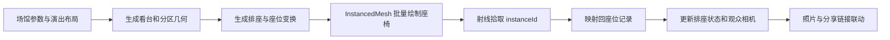

# 视野 Live：正式 REA 逆向拆解与重建评估

分析日期：2026-10-23。目标：[视野 Live · KSPO DOME](https://shijiao.xingpaste.com/?venue=kspo-dome&section=23&depth=40&lateral=50&standing=1&date=four-sided&layout=center&lang=zh)。

补充：后续已定位并下载 7 个按需加载的逐座 JSON，另有约 14.6 MB 数据。12 个脚本不等于全站完整数据。详见[数据来源追踪与下载清单](/Users/lilinhai/Projects/rea/shijiao-evidence/data-sources/README.md)。

## 1. 结论

**可以做。单馆体验属于中等难度；达到当前站点的完整产品和多馆覆盖，属于中高到高难度。**

这次正式 REA 脚本采集修正了一个关键判断：3D 的主要实现是参数化场馆、程序生成几何和实例化座椅，可以复用通用引擎。当前 `Stadium` 代码未见 GLTFLoader，不能据此断言整个网站永远不使用外部模型，但不能把工作量按“196 个完整美术模型”计算。

主要成本来自：

1. 场馆、分区、排座、不同演出舞台布局的数据整理与校准；
2. 2D、3D、座位选择、相机和照片筛选之间的状态同步及设备兼容；
3. 上传、图片处理、审核、账户归属、隐私、举报、内容运营的完整链路。

前端发布包中可确认 **196 个场馆条目**，这不等于 196 个场馆均有精确座位数据、同等 3D 质量或完整照片覆盖。多处数据说明明确把尺度、层高、排座称为示意估算。

以下工期是工程判断，不是从网站观测得到的事实。按熟练全栈开发、复用现成认证/存储/地图库、需求稳定估算：

| 交付目标 | 范围 | 日历时间与人员 |
|---|---|---|
| 单馆浏览 MVP | 已备好场馆数据和可用照片，2D 分区、筛选、移动端、分享链接 | 1–2 周，1 人 |
| 单馆 3D 演示 | 规则场馆、示意座位、分区/座位视角、少量照片联动 | 2–4 周，1 名熟悉 Three.js 的开发 |
| 可运营 V1 | 约 3–5 馆、登录、上传、对象存储、基础审核后台、举报、2D | 4–8 周，2 人 |
| 功能接近当前站 | 增加参数化 3D、兼容降级、回忆、轨迹、海报、账号绑定合并、运营功能 | 10–16 周，2–3 人 |
| 约 200 馆且逐馆核验 | 场馆图、演出布局、座位和视角校准、持续内容维护 | 需另立数据工作计划，不能包含在上述开发周数中 |

这些范围不是可直接相加的工序报价；高准确度实景还原、获取内容授权、冷启动照片和大规模运营另计。

## 2. REA 连接问题已经解决

Codex 重启后，正式 `mcp__rea` 已加载并可调用。原来的 `127.0.0.1:9222` 对 `/json/*` 返回 404，只能证明它不提供此次 REA 所需的发现接口；之前把原因直接断言为“扩展代理”证据不足。

本次由分析侧启动**独立临时配置的 Chrome**，使用 `127.0.0.1:9223`，正式 REA 成功发现页面、采集脚本并解析。无需修改日常浏览器，也无需再次重启 Codex。

已完成的正式分析：

- `inspect_web_page`：保留页面采集和脚本源码；
- `export_web_scripts`：导出 12 个脚本，总计 **2,967,237 bytes**，逐个 SHA-256 校验通过；
- `analyze_web_bundle`：12/12 脚本解析成功，0 个解析失败，访问 **559,601 个 AST 节点**；
- 静态分析报告的 completeness 为 **partial**，不是整个应用/全部运行路径的完整恢复；
- 12 个捕获脚本均未声明 source map URL，没有获得原始 TypeScript、开发目录或注释。

更深的 `analyze_javascript_application` 被本机 Xcode 许可未接受阻断。这不影响已完成的浏览器采集、bundle AST 和发布脚本阅读；没有替用户接受许可，也不需要先解决它才能使用本报告。

## 3. 产品结构与核心闭环

| 模块 | 页面可见能力 | 开发工作 |
|---|---|---|
| 实拍 | 按场馆/分区/演出/标签筛选、分页、照片详情、反馈 | 检索模型、缩略图、分页与空状态 |
| 探索 | 场馆/场次选择、2D/3D、楼层、分区、座位、站坐视角 | 几何数据、图形渲染、相机和状态同步 |
| 回忆 | 观演记录、图片、独立公开范围；发布脚本还有删除/恢复逻辑 | 记录版本、附件、隐私和公开展示 |
| 轨迹 | 场馆和城市足迹、2D 地图/3D 地球、年份、观演顺序线、海报 | 地理匹配、聚合、偏好同步、图片合成 |
| 我的 | 资料、绑定/合并、位置收藏、我的实拍、反馈和举报 | 账户归属、历史内容认领、状态管理 |

产品的主要使用链：选择演出/场馆 → 找分区 → 看模拟视角和真实照片 → 分享本人实拍 → 审核后丰富同一分区内容 → 形成个人回忆和足迹。

照片和场馆数据的覆盖会直接决定体验。只有相似界面、没有足够内容时，用户仍难以判断座位。

## 4. URL 与前端状态

这是带动态分包的 React 单页应用，构建产物有 Vite 特征。React/Vite 指纹由 REA 静态分析识别，业务模块导入和 React 调用也与此一致。

| 参数 | 已确认的含义与边界 |
|---|---|
| `venue` | 场馆 ID，例如 `kspo-dome` |
| `section` | 分区 ID，例如 `23`、`floor-a` |
| `depth` | 归一化排位置，源码公式 `(row - 0.5) / rowCount * 100` |
| `lateral` | 归一化排内座位位置，源码公式 `(seatIndex + 0.5) / rowSeats * 100` |
| `standing` | 站/坐视角状态 |
| `layout` | 舞台布局，例如 `center` |
| `date` | 场次/预览关联的字符串状态；入口值 `four-sided` 不能当作公历日期 |
| `lang` | 界面语言 |
| `tab`、`range` | 导航和照片范围，例如 `photos`、`venue` |

`depth=40` 不是 40 米、也不是第 40 排。分享链接可表达一个近似座位视角，具体精度取决于该场馆数据。

重建时宜把“场馆/演出/布局/分区/排座/相机模式”组成统一状态，由 2D、3D、照片筛选和 URL 共同读取；切场馆时要处理旧分区、旧场次失效的问题。

## 5. 发布脚本的职责与体量

大小指捕获的源码 UTF-8 字节量，不是 gzip 网络流量，也不是作者手写代码行数。

| 文件 | 字节量 | 源码审阅得到的主要内容 |
|---|---:|---|
| `index-BAj_84iQ.js` | 487,882 | React 等公共运行时、共享导出和启动代码 |
| `AppRoute-FKjE7l3d.js` | 386,271 | 主业务界面、账户、上传、回忆、轨迹和交互 |
| `data-CI2ywFAf.js` | 1,355,044 | 场馆、演出、布局、参考数据、几何和排座计算 |
| `Stadium-hdz890bx.js` | 108,962 | 场景、座位实例、拾取、渲染兼容、相机 |
| `OrbitControls-DcB4Swpe.js` | 593,491 | Three.js 引擎及控制相关代码，不只是一个相机控制器 |
| `photos-*.js` 两个分包 | 10,817 | 照片相关辅助逻辑和资源处理 |
| `PublicMemories-*.js` | 4,498 | 公开回忆展示 |
| `SelectField-*.js` | 5,274 | 选择器 |
| `request-*.js` | 1,191 | 超时、取消、JSON 响应和错误分类 |
| `useUnsavedChanges-*.js` | 869 | 未保存改动处理 |
| `jweixin-1.6.0.js` | 12,938 | 微信 JS SDK；存在 SDK 不证明所有分享能力均实际启用 |

数据文件约占这批源码的 46%。这解释了为什么数据整理与分包加载都值得关注。没有测到实际压缩后的首屏传输与真实用户性能，不能直接据此判断首屏慢。

## 6. 2D 座位图

页面观察确认 SVG 分区图，支持楼层、缩放、旋转、重置、分区照片数和点击选择。KSPO 显示 1F/2F/内场，编号看台和 A/B/C/D 站区。

可复用的数据结构应包括场馆、楼层、分区、多边形/路径、标签锚点、排座参数、舞台布局与演出覆盖配置。这里是重建建议，不能称为恢复的后端表结构。

2D 的实现难度主要在不规则分区、标签重叠、触摸手势和不同演出布局。图形可由配置生成；某些场馆仍需要专用区界或几何数据。页面有方向和估算提示，说明它定位于视野参考。

## 7. 3D 引擎：源码确认的实现

Three.js 版本可由引擎标记直接确认：**r185**。

渲染与交互链：



具体实现：

- 座椅使用 `InstancedMesh`，通过 `setMatrixAt` 放置；网格名包含 `estimated-seats`。
- 每个实例映射到 `userData.kaitakSeats` 的记录，射线拾取通过 `instanceId` 找到对应座位。
- 存在 near/far 两套座位网格，按相机到分组中心距离 **65 个场景单位**切换细节。不能把场景单位直接等同实际米数。
- 有总览、靠近分区、观众、手机取景、站坐、屋顶结构、重置等状态。
- 有 `requestAnimationFrame` 循环和 dirty 标记；这不能表述成“完全没有连续循环”。
- WebGL 配置有 standard 与 compatible 两档：标准档抗锯齿、像素比上限 1.6；兼容档关闭抗锯齿、低功耗、像素比 1。
- 另有软件 SVG 渲染降级，节点标记 `scene-software-surface` / `renderer=software`。
- 有截图、渲染器 dispose 和 context 释放相关逻辑。

最难复用的部分是“任意形状场馆 → 连贯排座 → 正确相机”的规则。规则馆体可快速出效果；复杂场馆的遮挡物、真实栏杆、摄像平台、音响塔、临时舞台和屏幕，则需要额外数据。

**模拟视角不能自动证明无遮挡。** 要把它做成可靠的座位建议产品，仍需实拍、布局版本和人工校准支持。

## 8. 场馆与演出数据资产

从 `data` 分包中解析出的静态记录：

| 数据集合 | 数量 | 说明 |
|---|---:|---|
| 扩展场馆记录 | 194 | 加 2 个内置场馆：鸟巢、KSPO DOME，共 196 |
| 日期化演出记录 | 352 | 包括 artist/title/venue/date/source/layoutId/mapUrl 等字段 |
| 另一类演出参考记录 | 61 | 字段和用途不同，不与上项直接合并计数 |
| 艺人—场馆—日期参考 | 63 | 带来源 URL |
| 第三方几何参考快照 | 6 | 含 source、snapshotSHA256、variants 等元信息 |

这些是本次发布包的静态条目数，不代表实际可售演出数量、唯一场次数或当前实时业务数据。

通用几何包含 `shape`、`power`、`floor` 和 `tiers[{a,b,base,depth,rise,steps}]`，并配有 `evidence`、`sources[{url,note}]`。这套结构适合把场馆参数与来源可信度一起维护。

KSPO 内置参数：`kind=arena`、`a=27`、`b=27`、`levels=2`、`defaultLayout=center`。数据附带 KSPO 官方活动页和座位图 URL，但不能把这些尺寸当成官网认证实测值。

部分参考快照的来源指向 `venue.flytix.live`。只能确认发布数据标注了这些参考来源，不能推导作者关系、后台共用或拥有其源码。

本次公开搜索未定位到可核实的项目源码仓库。已得到的是公开发布脚本及数据，服务端源码没有恢复。

## 9. 接口与后端拆分

以下为发布代码中人工核对的 URL 入口；**静态存在不等于本次全部调用成功**。没有访问管理员接口，也没有执行上传、绑定、合并或其他写入。

| 业务域 | 入口示例 |
|---|---|
| 登录与会话 | `/api/auth/options`、`get-session`、`sign-out` |
| 验证码登录 | `/api/auth/email-otp/send-verification-otp`、`sign-in/email-otp`、`phone` |
| 绑定与合并 | `/api/auth/bind/:method`、`/api/auth/merge/...`、`/api/auth/wechat/exchange` |
| 账户资料 | `/api/account/profile`、`avatar`、`summary`、`views` |
| 公开照片 | `/api/photos`、`/api/photos/:id/image`、`/api/photo-summary` |
| 作者管理 | `/api/account/photos/:id`、`/api/my-photos`、`/api/account/claim-photos` |
| 反馈举报 | `/api/photos/:id/helpful`、`report`、`/api/my-reports`、`/api/feedback`、`/api/feedback-mine/...` |
| 回忆 | `/api/account/memories`、`/:id`、`/:id/images`、`/:id/image/:index` |
| 足迹 | `/api/account/journey` |
| 统计 | `/api/analytics/collect` |

照片查询参数包括 `venue, section, scope, kind, event, layout, date, tag, page, pageSize`，页面使用分页，观察值 `pageSize=12`。

建议重建的服务域为认证/账户、场馆配置、照片与媒体、审核举报、回忆、足迹、统计。初期可以是同一后端内的模块，不需要为了这些边界直接拆成微服务。

数据库建议模型：`Venue / Section / Layout / Event / PhotoBatch / PhotoAsset / ModerationAction / Account / Identity / Memory / JourneySettings`。这是设计建议，数据库产品和真实表结构未知。

## 10. 图片链路、上传与可靠性

页面资源观察到图片 API 与 OSS 临时签名地址链路：

```text
浏览器 → /api/photos/:id/image → photos.xingpaste.com 对象存储签名地址
```

观察到 Aliyun OSS V4/STS 参数和约 120 秒有效期，缩略图带尺寸/质量处理参数。签名链接只是访问机制的一环，不能称为防止截图或彻底阻止复制。

上传表单观察：最多 4 张、每张 20 MB、JPG/PNG/WebP；备注 300 字、最多 6 个体验标签；包含场馆/分区、演出与日期、署名、本人拍摄及公开权利确认；提交后审核公开。

源码进一步确认：

- 默认请求超时 15 秒，使用 AbortController；same-origin credentials；检查 JSON 响应并封装 RequestError。
- 错误分类标记 5xx、408、409、429 等为可重试；这不等于所有请求自动重试。
- 上传通过 `POST /api/photos` 的 FormData，超时 90 秒。
- 提交前计算图片 SHA-256，构造载荷指纹，并发送 `Idempotency-Key` UUID；同一载荷可复用提交 ID，旨在处理重复提交。服务端是否正确兑现幂等仍未验证。
- 某些账户请求带 `X-Account-ID`，但前端 header 不能证明服务端权限校验方式或安全性。
- 头像在前端中心裁成 512×512、JPEG 编码。
- 隐私文案宣称图片重新编码/清理 EXIF/GPS；未检查后端代码或上传产物，不能把它当已验证的执行结果。

存在本机上传关联标识与 `claim-photos` 认领逻辑，所以不能简单假设“必须登录才能上传”。匿名提交的完整规则本次未实际验证。

重建时最小可运营链需要上传校验、存储、缩略图、处理状态、审核、作者归属、下架/删除与失败恢复；这些才是照片表单背后的工作量。

## 11. 回忆、轨迹、隐私与并发

回忆与照片共享部分内容，但有独立记录、附件和公开范围。源码中有 revision、删除及恢复请求，说明需要处理记录版本和状态变化。

轨迹从场馆/城市与实拍构建，不应当误当成 GPS 实时轨迹。页面有年份、城市、场馆、顺序线、2D/3D 模式；资源包含 `journey/land.json`、`city-areas.json`，并标注 Natural Earth/OpenStreetMap。

轨迹设置保存携带 `revision`，前端先更新、失败回滚，体现乐观并发控制意图。真正的冲突拒绝规则仍依赖未见的服务端。

海报在前端通过 **1080×1440 Canvas** 合成为 PNG，代码要求使用审核通过的照片。这部分可用成熟 Canvas/地图方案实现，主要复杂度是封面选择、图片跨域和导出稳定性。

权限需要分别覆盖公开浏览、作者管理、本机历史认领、登录账户、回忆可见性和运营审核；不能只做一个 `isLoggedIn` 判断。

## 12. 性能、兼容与质量要求

当前实现已经为座椅实例化、远近细节、像素比、软件降级、资源清理和分页投入工程工作，完整重建时要为这些留时间。

建议验收围绕真实使用路径，而不是“画面能显示”：

- 低性能手机打开大馆、切换场馆及反复进出 3D，内存是否持续增长；
- 点座与 URL 恢复是否一致，切演出布局后是否留下失效分区；
- 网络中断、上传超时及重复点击是否产生重复内容或丢失表单；
- 签名图片过期后是否可刷新，海报能否稳定导出；
- 回忆私密内容、已下架照片与账户合并是否正确隔离；
- 键盘、触摸、缩放、屏幕阅读器能否完成主要任务。

本次没有进行压测、权限攻击测试或真实用户性能统计，不对生产容量和安全性作结论。

## 13. 我们怎样做更实际

**先完成一个场馆的“找位置—看实拍—分享补充”闭环。** 已有数据和照片的前提下，先做 2D；随后用一个规则馆体验证参数化 3D 的准确度和设备表现。

建议阶段：

1. 选 1 馆、2–3 种舞台布局，建立有来源与可信度标记的分区/排座数据，完成可分享 URL 和照片浏览。
2. 补上传、邮箱登录、本机历史归属、审核后台和举报，验证内容能持续进入系统。
3. 用相同场馆加入程序生成 3D、座椅拾取、观众相机及降级；通过真实照片核对视角。
4. 再扩充到 3–5 馆并沉淀配置工具；回忆、轨迹、海报和复杂账号合并随后推进。

推荐自建方案：React + TypeScript + SVG + Three.js，熟悉的服务端框架 + PostgreSQL，S3 兼容对象存储/CDN，媒体处理任务队列和轻量运营后台。这是实现建议，**不是原站服务端栈的鉴定**。

若核心价值是帮助买票用户判断视野，首轮应优先投入照片质量、分区筛选和数据可信度。3D 很有吸引力，但其可信度来自场馆数据和实拍校准。

## 14. 证据、覆盖与未知

### 正式 REA 证据文件

- [原始页面与脚本采集](/Users/lilinhai/Projects/rea/shijiao-evidence/page-capture.json)：`ev_bd476673da88dd1777160e0ddf3e7aa1e1019833c6651c78efab6e684f63c353`
- [脚本导出清单与 SHA-256](/Users/lilinhai/Projects/rea/shijiao-evidence/scripts/manifest.json)：12 个脚本，来自上述 capture。
- [重新核验的正式 REA bundle](/Users/lilinhai/Projects/rea/shijiao-evidence/rea-evidence-verified.json)：浏览器 target 与 bundle 分析两条记录。
- [bundle 静态分析](/Users/lilinhai/Projects/rea/shijiao-evidence/bundle-analysis.json)：`ev_1f87574d159d170f4c5cad6ff7216e4cec76c521e7987993869b76591d156cd0`
- [人工代码锚点索引](/Users/lilinhai/Projects/rea/shijiao-evidence/code-findings.json)：20 个关键位置，含文件、SHA-256、字符/字节偏移与上下文。它是人工审阅索引，不是 REA 动态执行轨迹。

### 证据等级

- **直接观察**：页面交互/表单、发布脚本、API URL 字符串、Three.js 版本、座位实例化、参数公式、上传 header、静态数据条目。
- **推断与建议**：服务域/数据库设计、重建路线、人员工期、复用引擎后的成本判断。
- **未知**：服务端框架与源码、真实数据库、后台全流程、权限检查、媒体清理执行效果、流量/成本、所有场馆精度与完整运行路径。

采集发生在页面加载后，不能补回 attach 前全部网络/console 历史。仅分析许可域脚本，未采集 Cookie、存储值或完整敏感 headers/body；未加载的后台或业务分包不在本次范围。没有把静态 URL 候选全部当真实接口调用，也没有把全部脚本解析成功等同整个应用恢复完成。

本报告完成的是公开产品与前端发布实现的拆解，可用于确定重建范围和预算；不包含原站完整源码恢复。
